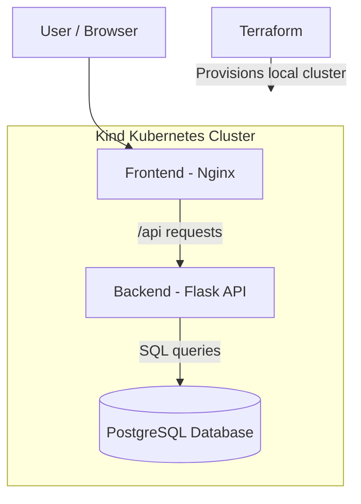

# Employee Management System – 3-Tier DevOps Project

A containerized Employee Management application deployed using Docker, Kubernetes (Kind), and Terraform. This project demonstrates a practical DevOps workflow covering application containerization, database integration, Kubernetes orchestration, infrastructure provisioning, and deployment verification.

## Project Overview

This project implements a three-tier architecture:

- **Frontend:** HTML and Nginx
- **Backend:** Python Flask and Gunicorn REST API
- **Database:** PostgreSQL 16

The application supports employee record management through a web interface. Docker Compose is used for local multi-container deployment, while Kubernetes (Kind) is used for container orchestration. Terraform provisions the local Kubernetes cluster.

## Architecture



## Technology Stack

| Category | Technologies |
|---|---|
| Frontend | HTML, Nginx |
| Backend | Python, Flask, Gunicorn |
| Database | PostgreSQL 16 |
| Containerization | Docker |
| Local orchestration | Docker Compose |
| Container orchestration | Kubernetes |
| Local Kubernetes cluster | Kind |
| Infrastructure as Code | Terraform |
| Version control | Git, GitHub |
| CI/CD foundation | GitHub repository and deployment workflow |

## Project Structure

```text
eks-3tier-devops-project/
│
├── backend/
│   ├── app.py
│   ├── init.sql
│   ├── requirements.txt
│   └── Dockerfile
│
├── frontend/
│   ├── index.html
│   ├── nginx.conf
│   └── Dockerfile
│
├── k8s/
│   ├── postgres.yaml
│   ├── backend.yaml
│   └── frontend.yaml
│
├── terraform/
│   └── main.tf
│
├── screenshots/
│   └── employee-management-project/
│
├── docker-compose.yml
├── .gitignore
└── README.md
```

## Application Deployment Using Docker Compose

### Prerequisites

- Ubuntu / Linux
- Docker
- Docker Compose

### 1. Clone the repository

```bash
git clone https://github.com/Rajaneesh2410/eks-3tier-devops-project.git
cd eks-3tier-devops-project
```

### 2. Configure environment variables

Create a local `.env` file:

```bash
nano .env
```

Add the following configuration, replacing the example password with your own strong password:

```env
POSTGRES_DB=employees
POSTGRES_USER=admin
POSTGRES_PASSWORD=replace_with_a_strong_password

DB_HOST=db
DB_NAME=employees
DB_USER=admin
DB_PASSWORD=replace_with_the_same_password
```

The `.env` file is excluded from Git using `.gitignore`.

### 3. Build and start the containers

```bash
docker compose up -d --build
```

### 4. Verify containers

```bash
docker compose ps
```

### 5. Access the application

Open:

`http://localhost:8081`

### 6. Stop the application

```bash
docker compose down
```

## Kubernetes Deployment Using Kind

This project uses Kind to run a local Kubernetes cluster.

### Prerequisites

- Docker
- kubectl
- Kind
- Terraform

### 1. Provision the Kubernetes cluster using Terraform

```bash
cd terraform
terraform init
terraform validate
terraform plan
terraform apply
```

Confirm the operation when prompted.

### 2. Verify the cluster

```bash
kubectl get nodes
```

### 3. Build the application images

From the project root:

```bash
cd ..
docker build -t employee-backend:v1 ./backend
docker build -t employee-frontend:v2 ./frontend
```

### 4. Load images into Kind

```bash
kind load docker-image employee-backend:v1 --name terraform-devops-cluster
kind load docker-image employee-frontend:v2 --name terraform-devops-cluster
```

### 5. Create the PostgreSQL Kubernetes Secret

Create the Secret locally before deploying the manifests. Replace the example password with your own:

```bash
kubectl create secret generic postgres-secret \
  --from-literal=POSTGRES_USER=admin \
  --from-literal=POSTGRES_PASSWORD='replace_with_a_strong_password' \
  --from-literal=POSTGRES_DB=employees
```

Do not commit real credentials to GitHub.

### 6. Deploy the application

```bash
kubectl apply -f k8s/postgres.yaml
```

Wait for PostgreSQL to become ready:

```bash
kubectl rollout status deployment/postgres
```

Deploy the backend and frontend:

```bash
kubectl apply -f k8s/backend.yaml
kubectl apply -f k8s/frontend.yaml
```

### 7. Verify Kubernetes resources

```bash
kubectl get pods
kubectl get services
kubectl get deployments
```

### 8. Access the application

Forward the frontend service to your local machine:

```bash
kubectl port-forward service/employee-frontend-service 8083:80
```

Open:

`http://localhost:8083`

Keep the port-forward terminal running while accessing the application.

## Infrastructure as Code – Terraform

Terraform provisions the local Kind cluster using the `tehcyx/kind` provider.

Configuration highlights:

- Cluster name: `terraform-devops-cluster`
- Kubernetes node image: `kindest/node:v1.31.0`
- Node role: Control plane

Useful commands:

```bash
terraform init
terraform validate
terraform plan
terraform apply
terraform state list
terraform destroy
```

**Note:** `terraform destroy` deletes the Terraform-managed local Kind cluster. Use it only when you intend to remove the cluster.

## Database and Storage

PostgreSQL is deployed as a Kubernetes Deployment with:

- PostgreSQL 16 container image
- PersistentVolumeClaim requesting 1 GiB storage
- Kubernetes Secret for database credentials
- ClusterIP Service for internal database communication

The backend connects to PostgreSQL through the internal Kubernetes service named `postgres-service`.

## Project Screenshots

### 1. Application Dashboard


### 2. Database Records


### 3. Docker Compose Containers


### 4. Docker Images


### 5. Kubernetes Pods


### 6. Kubernetes Services


### 7. Kubernetes Deployments


### 8. Terraform Plan


### 9. GitHub Repository


## Key DevOps Skills Demonstrated

- Containerizing frontend and backend applications using Docker.
- Managing multi-container applications using Docker Compose.
- Configuring service-to-service communication.
- Deploying applications using Kubernetes Deployments and Services.
- Managing persistent database storage using PVCs.
- Handling database credentials using Kubernetes Secrets.
- Provisioning local Kubernetes infrastructure using Terraform.
- Managing source code and project documentation using Git and GitHub.
- Troubleshooting container, networking, and Kubernetes deployment issues.

## Future Improvements

- Implement a complete CI/CD pipeline using Jenkins or GitHub Actions.
- Integrate Argo CD for GitOps-based deployments.
- Add Prometheus and Grafana for monitoring.
- Introduce Kubernetes Ingress.
- Deploy the application to a managed cloud Kubernetes service.

## Author

**Rajaneesh**

GitHub: https://github.com/Rajaneesh2410

