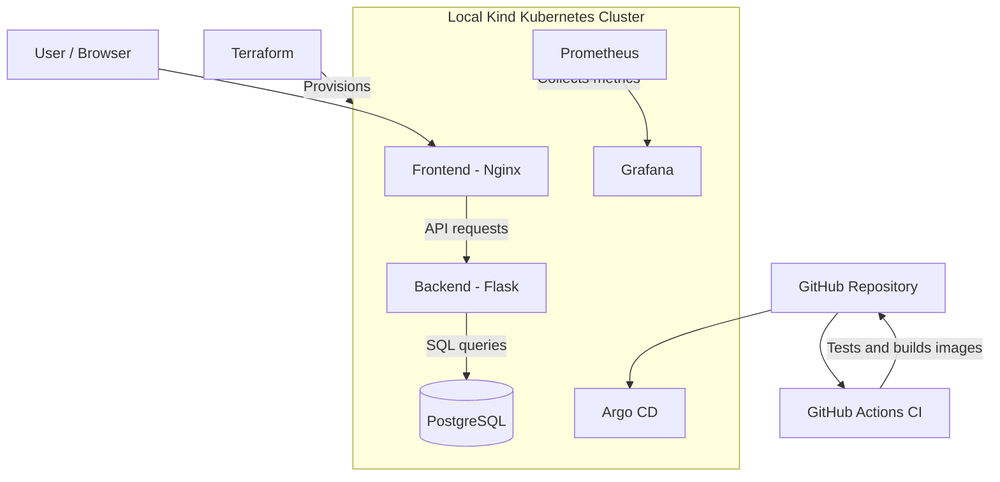
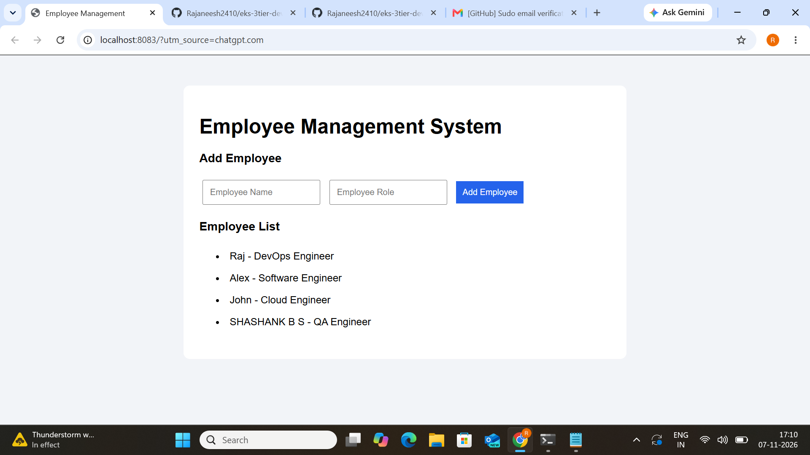
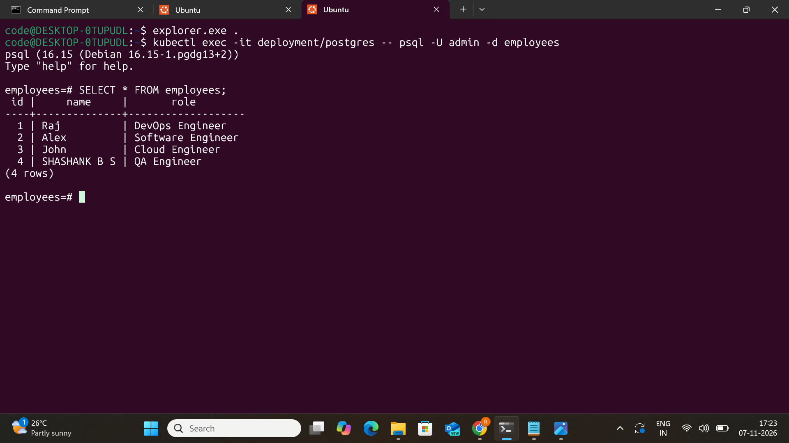
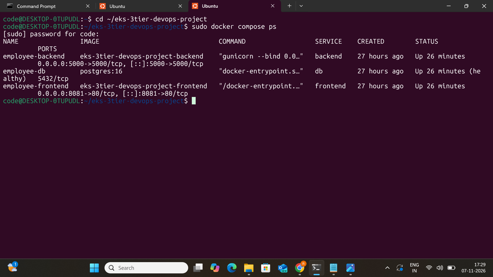
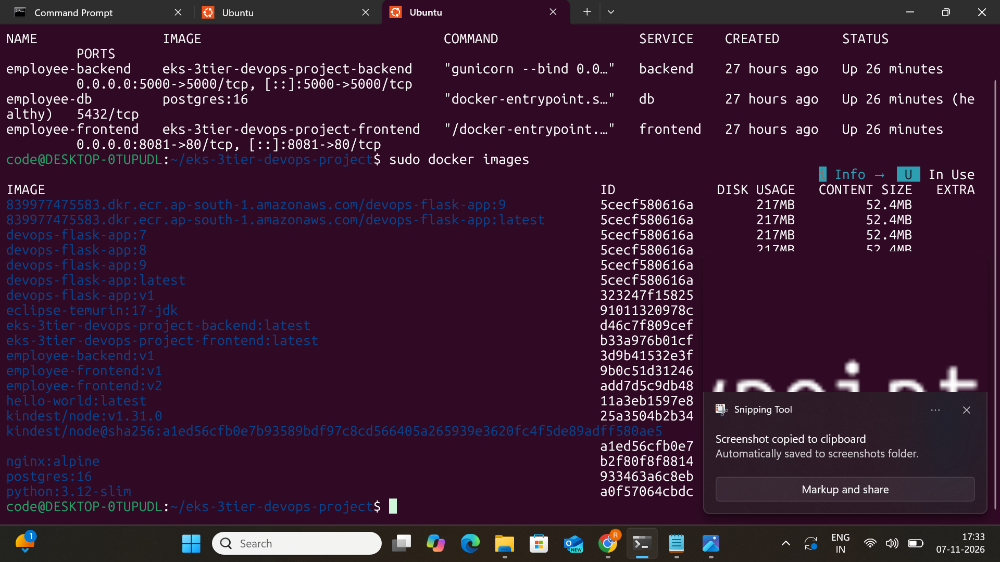
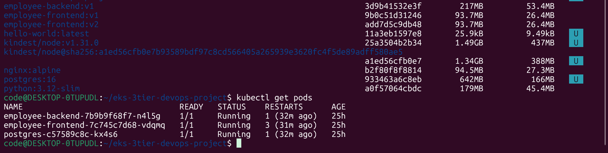
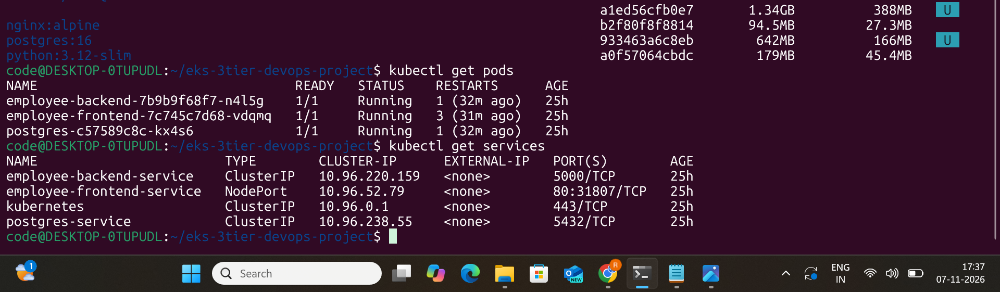
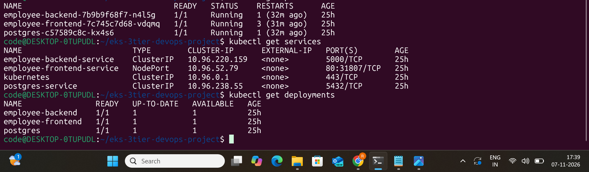
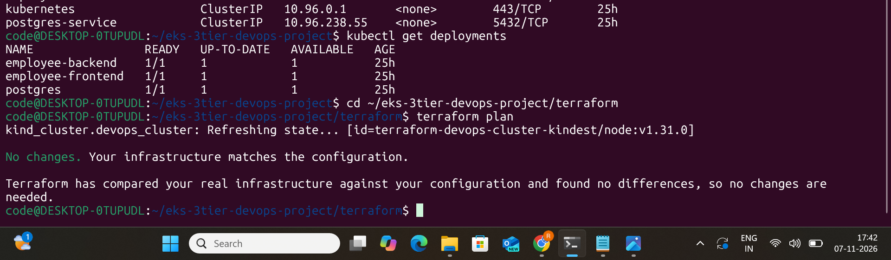
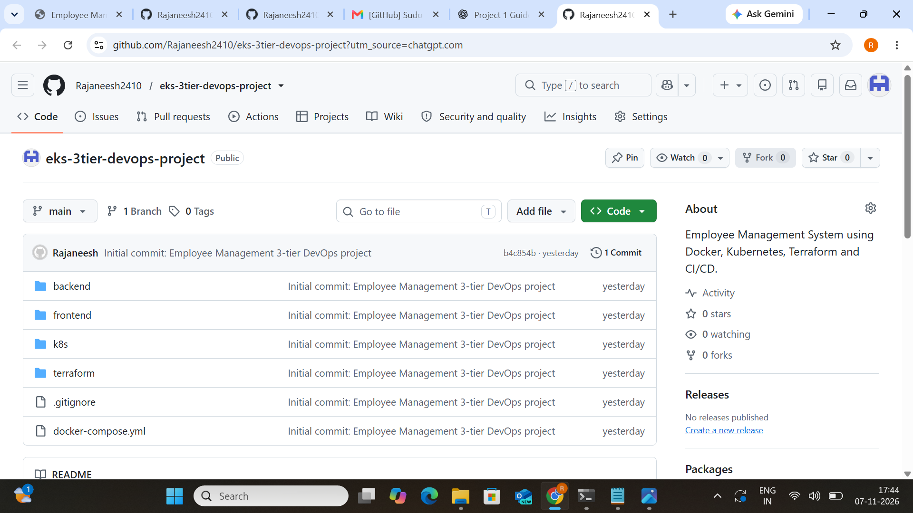

# Employee Management System – 3-Tier DevOps Project

A containerized Employee Management application deployed on a local Kubernetes cluster using Docker, Kind, and Terraform. This project demonstrates an end-to-end DevOps workflow involving application containerization, CI automation, Kubernetes orchestration, GitOps deployment, infrastructure as code, and monitoring.

## Project Overview

The application follows a three-tier architecture:

- **Frontend:** HTML and Nginx
- **Backend:** Python Flask and Gunicorn REST API
- **Database:** PostgreSQL 16

The project uses Docker Compose for local application deployment and Kubernetes (Kind) for container orchestration. Terraform provisions the local Kind cluster. GitHub Actions automates testing and image builds, Argo CD manages GitOps-based deployment, and Prometheus and Grafana provide monitoring.

## Architecture



## Technology Stack

| Category | Technologies |
|---|---|
| Frontend | HTML, Nginx |
| Backend | Python, Flask, Gunicorn |
| Database | PostgreSQL 16 |
| Containerization | Docker |
| Local multi-container deployment | Docker Compose |
| Container orchestration | Kubernetes |
| Local Kubernetes cluster | Kind |
| Infrastructure as Code | Terraform |
| CI automation | GitHub Actions |
| GitOps / Continuous Delivery | Argo CD |
| Monitoring | Prometheus, Grafana, Alertmanager |
| Version control | Git, GitHub |
| Operating environment | Ubuntu on WSL |

## Project Structure

```text
eks-3tier-devops-project/
│
├── .github/
│   └── workflows/
│       └── ci.yml
│
├── backend/
│   ├── app.py
│   ├── init.sql
│   ├── requirements.txt
│   ├── Dockerfile
│   └── tests/
│       └── test_app.py
│
├── frontend/
│   ├── index.html
│   ├── nginx.conf
│   └── Dockerfile
│
├── k8s/
│   ├── postgres.yaml
│   ├── backend.yaml
│   └── frontend.yaml
│
├── terraform/
│   └── main.tf
│
├── argocd/
│
├── screenshots/
│   └── employee-management-project/
│
├── docker-compose.yml
├── .gitignore
└── README.md
```

## 1. Run the Application Using Docker Compose

### Prerequisites

- Ubuntu / Linux
- Docker
- Docker Compose

### Clone the repository

```bash
git clone https://github.com/Rajaneesh2410/eks-3tier-devops-project.git
cd eks-3tier-devops-project
```

### Configure environment variables

Create a local `.env` file:

```bash
nano .env
```

Add the following configuration and replace the example password with your own:

```env
POSTGRES_DB=employees
POSTGRES_USER=admin
POSTGRES_PASSWORD=replace_with_a_strong_password

DB_HOST=db
DB_NAME=employees
DB_USER=admin
DB_PASSWORD=replace_with_the_same_password
```

The `.env` file is excluded from Git using `.gitignore`. Never commit real credentials.

### Build and start the containers

```bash
docker compose up -d --build
```

Verify the containers:

```bash
docker compose ps
```

Access the application:

```text
http://localhost:8081
```

Stop the application:

```bash
docker compose down
```

## 2. Kubernetes Deployment Using Kind

### Prerequisites

- Docker
- kubectl
- Kind
- Terraform

### Provision the local Kubernetes cluster

```bash
cd terraform
terraform init
terraform validate
terraform plan
terraform apply
```

Confirm the operation when prompted.

Verify the cluster:

```bash
kubectl get nodes
kubectl config current-context
```

### Build the application images

From the project root:

```bash
cd ..
docker build -t employee-backend:v1 ./backend
docker build -t employee-frontend:v2 ./frontend
```

### Load images into Kind

```bash
kind load docker-image employee-backend:v1 --name terraform-devops-cluster
kind load docker-image employee-frontend:v2 --name terraform-devops-cluster
```

### Create the PostgreSQL Secret

Create the database Secret locally before deploying the Kubernetes manifests. Replace the example password with your own:

```bash
kubectl create secret generic postgres-secret \
  --from-literal=POSTGRES_USER=admin \
  --from-literal=POSTGRES_PASSWORD='replace_with_a_strong_password' \
  --from-literal=POSTGRES_DB=employees
```

Do not store actual credentials in GitHub.

### Deploy the application

Deploy PostgreSQL first:

```bash
kubectl apply -f k8s/postgres.yaml
kubectl rollout status deployment/postgres
```

Deploy the backend and frontend:

```bash
kubectl apply -f k8s/backend.yaml
kubectl apply -f k8s/frontend.yaml
```

Verify the resources:

```bash
kubectl get pods
kubectl get services
kubectl get deployments
```

### Access the application

```bash
kubectl port-forward service/employee-frontend-service 8083:80
```

Open:

```text
http://localhost:8083
```

Keep the port-forward terminal open while accessing the application.

## 3. Infrastructure as Code – Terraform

Terraform provisions the local Kind Kubernetes cluster using the Kind provider.

Configuration highlights:

- Cluster name: `terraform-devops-cluster`
- Kubernetes node image: `kindest/node:v1.31.0`
- Node role: Control plane

Useful Terraform commands:

```bash
terraform init
terraform validate
terraform plan
terraform apply
terraform state list
terraform destroy
```

**Note:** `terraform destroy` deletes the Terraform-managed local Kind cluster. Use it only when you intend to remove the cluster.

## 4. CI Automation – GitHub Actions

A GitHub Actions workflow is configured in `.github/workflows/ci.yml`.

The workflow performs:

1. Checks out the source code.
2. Sets up Python.
3. Installs backend dependencies.
4. Runs backend tests using pytest.
5. Builds the backend Docker image.
6. Builds the frontend Docker image.

The backend test suite includes checks for the application health endpoint and frontend-serving route.

**Verification:** The workflow completed successfully on GitHub Actions, with both tests passing and the backend and frontend images building successfully.

This workflow demonstrates Continuous Integration (CI). It does not currently publish images to a container registry or deploy them automatically.

## 5. GitOps Deployment – Argo CD

Argo CD is installed in the local Kind cluster and connected to the GitHub repository.

Application configuration:

- Application name: `employee-management`
- Repository: `https://github.com/Rajaneesh2410/eks-3tier-devops-project`
- Branch: `main`
- Manifest path: `k8s`
- Destination namespace: `default`
- Sync policy: Automatic

The Argo CD application was verified with:

- **Application health:** Healthy
- **Sync status:** Synced

Argo CD monitors the configured Git repository path and reconciles the Kubernetes resources with the declared manifests.

The PostgreSQL Secret is created separately in the cluster and is not stored in the Git repository.

## 6. Monitoring – Prometheus and Grafana

The Prometheus Community `kube-prometheus-stack` Helm chart was installed in the `monitoring` namespace.

Components deployed:

- **Prometheus:** Collects and stores monitoring metrics.
- **Grafana:** Provides dashboards for visualizing metrics.
- **Alertmanager:** Handles alert notifications.
- **Node Exporter:** Exposes node-level metrics.
- **Kube State Metrics:** Exposes Kubernetes object and resource-state metrics.

Install Helm repository and monitoring stack:

```bash
helm repo add prometheus-community https://prometheus-community.github.io/helm-charts
helm repo update

kubectl create namespace monitoring

helm install monitoring prometheus-community/kube-prometheus-stack -n monitoring
```

Check monitoring pods:

```bash
kubectl get pods -n monitoring
```

### Access Grafana

```bash
kubectl port-forward svc/monitoring-grafana -n monitoring 3000:80
```

Open:

```text
http://localhost:3000
```

Get the initial admin password:

```bash
kubectl get secret monitoring-grafana -n monitoring \
  -o jsonpath="{.data.admin-password}" | base64 -d
echo
```

Login with username `admin` and the retrieved password.

### Access Prometheus

```bash
kubectl port-forward svc/monitoring-kube-prometheus-prometheus -n monitoring 9090:9090
```

Open:

```text
http://localhost:9090
```

These port-forward commands provide temporary local access while their terminals remain running.

## 7. Database and Storage

PostgreSQL is deployed in Kubernetes with:

- PostgreSQL 16 container image
- PersistentVolumeClaim requesting 1 GiB storage
- Kubernetes Secret for database credentials
- ClusterIP Service for internal database communication

The backend connects to PostgreSQL through the internal Kubernetes service named `postgres-service`.

## 8. Project Screenshots

The repository includes screenshots demonstrating the application and deployment setup.

### Application Dashboard



### Database Records



### Docker Compose Containers



### Docker Images



### Kubernetes Pods



### Kubernetes Services



### Kubernetes Deployments



### Terraform Plan



### GitHub Repository



## 9. Key DevOps Skills Demonstrated

- Containerizing applications using Docker.
- Managing multi-container applications using Docker Compose.
- Configuring application and database communication.
- Deploying applications using Kubernetes Deployments and Services.
- Managing persistent database storage using PVCs.
- Managing application credentials using Kubernetes Secrets.
- Provisioning local Kubernetes infrastructure using Terraform.
- Automating tests and Docker image builds using GitHub Actions.
- Implementing GitOps-based deployment using Argo CD.
- Monitoring Kubernetes resources using Prometheus and Grafana.
- Troubleshooting container, networking, storage, and Kubernetes deployment issues.

## 10. Future Improvements

- Add a container registry publishing stage to GitHub Actions.
- Implement automated deployment after successful CI builds.
- Configure Kubernetes Ingress and external access.
- Add application-specific Grafana dashboards and alert rules.
- Deploy the application to a managed cloud Kubernetes service.

## Author

**Rajaneesh**

GitHub: https://github.com/Rajaneesh2410
